# TP2 – Gestion des branches avec Git

## 1. Présentation du TP

**Module :** DevOps  
**Sujet :** Travailler avec les branches Git  
**Environnement :** Ubuntu Linux  
**Outil utilisé :** Git  
**Dépôt GitHub :** [Labs-Git](https://github.com/hyybaafarhat-bit/Labs-Git)

### Objectifs

- Comprendre le fonctionnement de Git.
- Créer et gérer plusieurs branches.
- Développer plusieurs fonctionnalités d'un site Web.
- Fusionner les branches.
- Créer un tag.
- Détecter et résoudre les conflits.
- Publier le projet sur GitHub.

---

## 2. Configuration de Git

### 2.1 Personnalisation du terminal

Modification du fichier `.bashrc` :

```bash
vim ~/.bashrc
```

Ajout de la fonction permettant d'afficher la branche Git :

```bash
parse_git_branch() {
    git branch 2> /dev/null | sed -e '/^[^*]/d' -e 's/* \(.*\)/(\1)/'
}
```

Personnalisation de l'invite :

```bash
export PS1="[\u@\h \w]\$(parse_git_branch)\$ "
```

Application des modifications :

```bash
source ~/.bashrc
```

### 2.2 Création d'un alias Git

```bash
git config --global alias.lgone 'log --oneline --decorate'
```

Cet alias permet d'afficher l'historique des commits sur une seule ligne.

---

## 3. Création du projet Web

### 3.1 Création de l'arborescence

```bash
mkdir -p website/{site-prod,site-dev}
cd website
```

- `site-prod` : contient les fichiers du site en production.
- `site-dev` : contient les nouvelles fonctionnalités en développement.

### 3.2 Initialisation du dépôt

```bash
git init
```

### 3.3 Création de la première page HTML

```bash
echo '<h1>Hello World!</h1>' > site-prod/index.html
```

Ajout des fichiers :

```bash
git add -A
git status
```

Premier commit :

```bash
git commit -m "The beginnings of my web site."
```

Vérification :

```bash
git lgone
```

---

## 4. Création de la branche new-features

Création de la branche :

```bash
git branch new-features
```

Vérification :

```bash
git branch
```

Passage vers la nouvelle branche :

```bash
git checkout new-features
```

### 4.1 Création de la page Contact

```bash
echo 'Contact : prenom.nom@gmail.com' > site-dev/contact.html
```

Ajout et validation :

```bash
git add -A
git status
git commit -m "Added contact.html file"
```

### 4.2 Création de la page Help

```bash
echo 'Help : God bless you' > site-dev/help.html
```

Ajout et validation :

```bash
git add -A
git commit -m "Added help.html file"
```

Vérification de l'historique :

```bash
git lgone
```

---

## 5. Création de la branche php-features

Retour vers master :

```bash
git checkout master
```

Création et changement de branche :

```bash
git checkout -b php-features
```

Vérification :

```bash
git branch
```

### 5.1 Création de la page PHP

```bash
nano site-dev/index.php
```

Contenu du fichier :

```php
<!DOCTYPE html>
<html>
<body>
<h1>My first PHP page</h1>
<?php
echo "Hello World!";
?>
</body>
</html>
```

Ajout et commit :

```bash
git add -A
git commit -m "Added index.php"
```

Vérification :

```bash
git lgone
```

---

## 6. Modification de la branche master

Retour vers master :

```bash
git checkout master
```

Création du fichier README :

```bash
nano README.md
```

Contenu initial :

```text
My First HTML Site
```

Modification de la page HTML :

```bash
nano site-prod/index.html
```

Ajout d'une structure HTML complète avec :

- HTML5
- Meta charset
- Viewport
- Title
- Heading

Ajout et validation :

```bash
git add -A
git status
git commit -m "Added html skeleton to index.html and README.md"
```

---

## 7. Fusion de la branche new-features

Sur la branche master :

```bash
git merge new-features
```

Cette opération permet d'intégrer les deux fichiers :

- `site-dev/contact.html`
- `site-dev/help.html`

Vérification :

```bash
git lgone
git lgone --graph
```

Les modifications de new-features sont maintenant intégrées dans master.

### 7.1 Suppression de la branche

```bash
git branch -d new-features
```

Vérification :

```bash
git branch
```

La branche new-features peut être supprimée après sa fusion.

---

## 8. Création d'un tag

Création d'une version :

```bash
git tag v0.1
```

Vérification :

```bash
git tag
git lgone
```

Le tag `v0.1` permet d'identifier une version précise du projet.

---

## 9. Gestion des conflits de fusion (Merge Conflicts)

La branche php-features n'étant pas encore fusionnée, une modification supplémentaire est réalisée.

### 9.1 Modification de README.md dans php-features

```bash
git checkout php-features
```

Modification :

```bash
nano README.md
```

Contenu :

```text
My First PHP Site
```

Ajout et commit :

```bash
git add -A
git commit -m "Added README.md file"
```

### 9.2 Retour vers master

```bash
git checkout master
```

Visualisation de l'historique :

```bash
git log --oneline --decorate --graph --all
```

### 9.3 Tentative de fusion

```bash
git merge php-features
```

Git détecte un conflit :

```text
CONFLICT (add/add): Merge conflict in README.md
Automatic merge failed
```

Vérification :

```bash
git status
```

Le fichier README.md contient deux versions différentes.

---

## 10. Résolution du conflit

Ouverture du fichier :

```bash
nano README.md
```

Le conflit ressemble à ceci :

```text
<<<<<<< HEAD
My First HTML Site
=======
My First PHP Site
>>>>>>> php-features
```

Résolution manuelle en conservant les deux idées :

```text
My First HTML-PHP Site
```

Enregistrement du fichier.

### 10.1 Validation de la résolution

```bash
git add -A
```

Vérification :

```bash
git status
```

Finalisation de la fusion :

```bash
git commit -m "Merge branch 'php-features'"
```

### 10.2 Vérification de l'historique final

```bash
git log --oneline --decorate --graph
```

Le résultat permet de visualiser les commits et les différentes fusions réalisées.

---

## 11. Publication sur GitHub

Le projet est publié sur GitHub afin de conserver une copie distante du travail.

Vérification du dépôt distant :

```bash
git remote -v
```

Publication de la branche master :

```bash
git push -u origin master
```

Dépôt GitHub :

https://github.com/hyybaafarhat-bit/Labs-Git

---

## 12. Captures d'écran du TP

Les 32 captures suivantes présentent le déroulement du TP, dans leur ordre chronologique.

### Galerie des captures

#### Capture 01

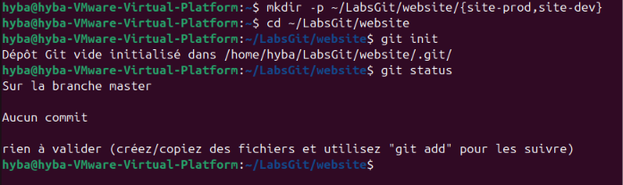

#### Capture 02

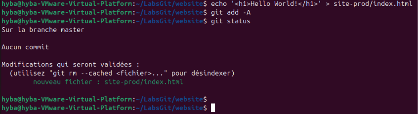

#### Capture 03

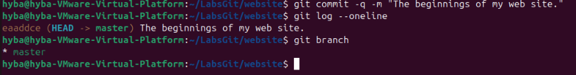

#### Capture 04

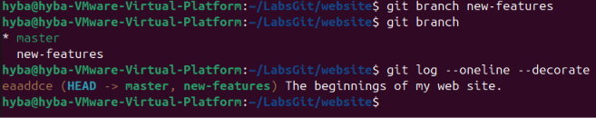

#### Capture 05

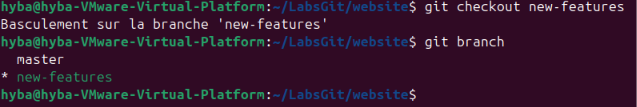

#### Capture 06

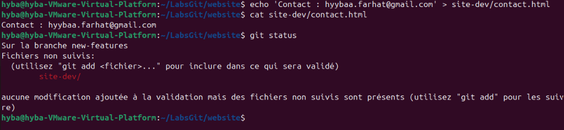

#### Capture 07

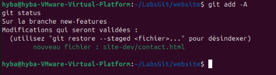

#### Capture 08

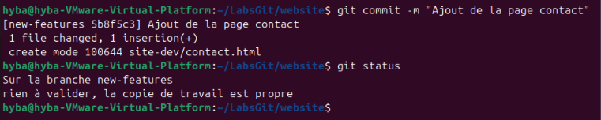

#### Capture 09

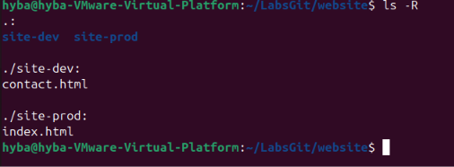

#### Capture 10

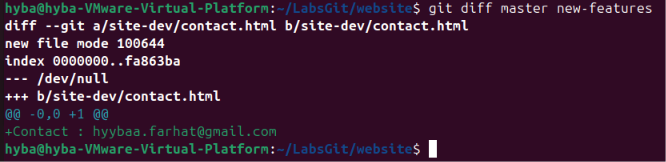

#### Capture 11

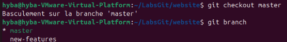

#### Capture 12

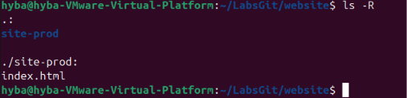

#### Capture 13

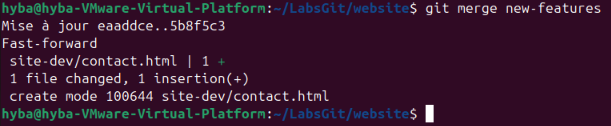

#### Capture 14

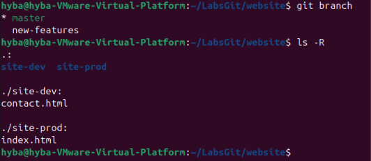

#### Capture 15

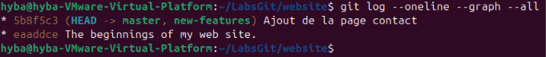

#### Capture 16

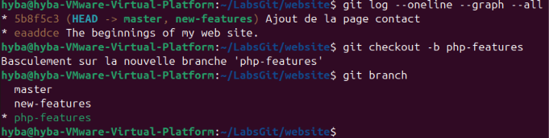

#### Capture 17

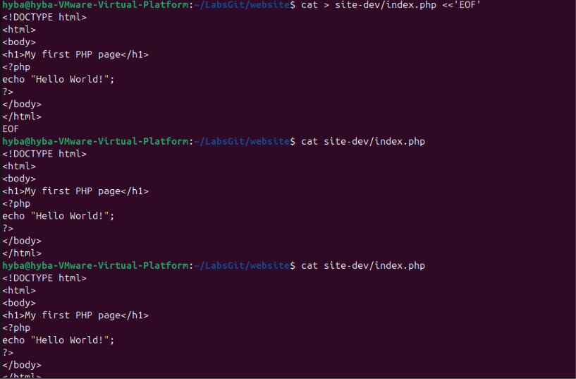

#### Capture 18

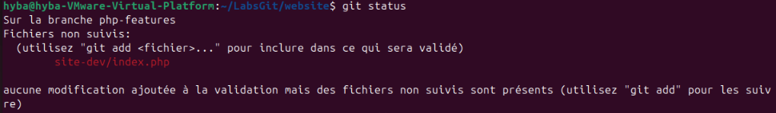

#### Capture 19

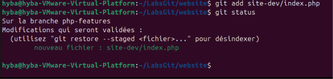

#### Capture 20

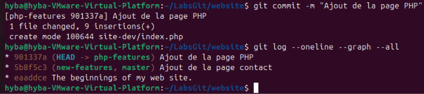

#### Capture 21

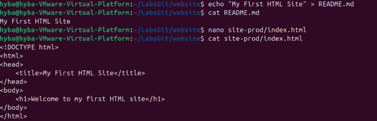

#### Capture 22

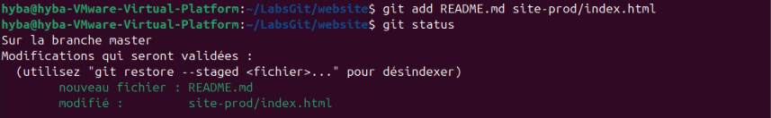

#### Capture 23

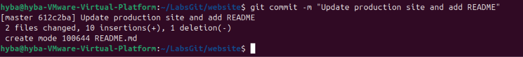

#### Capture 24

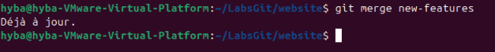

#### Capture 25

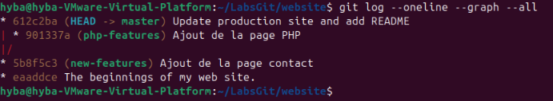

#### Capture 26

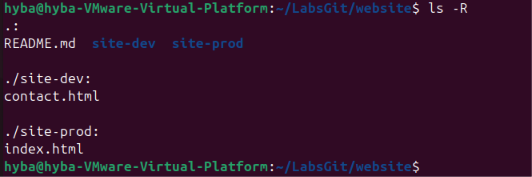

#### Capture 27

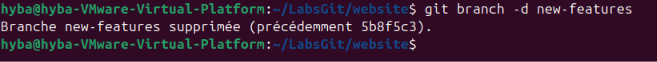

#### Capture 28

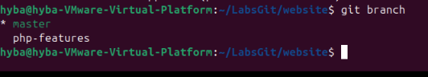

#### Capture 29

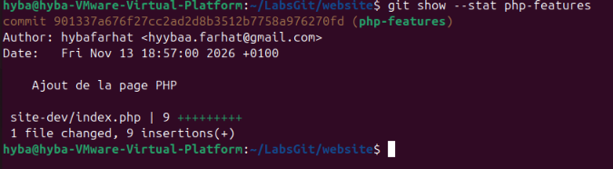

#### Capture 30

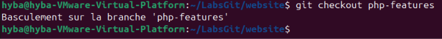

#### Capture 31

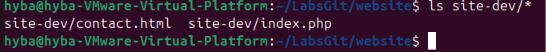

#### Capture 32

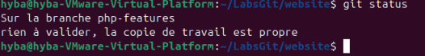

---

## 13. Conclusion

Ce TP m'a permis de mettre en pratique les principales fonctionnalités de Git :

- Initialisation d'un dépôt local.
- Configuration de Git.
- Création et gestion des branches.
- Gestion des commits.
- Fusion des branches.
- Création des tags.
- Détection et résolution des conflits.
- Publication du projet sur GitHub.

Ce travail m'a permis de mieux comprendre l'importance de Git dans la gestion des versions et le travail collaboratif.

**Repository GitHub :**

https://github.com/hyybaafarhat-bit/Labs-Git


---


## 14. Captures du Lab 1

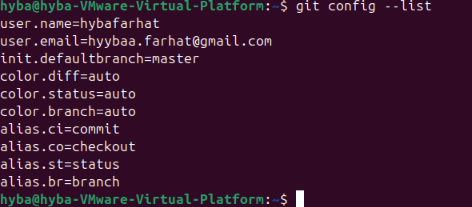

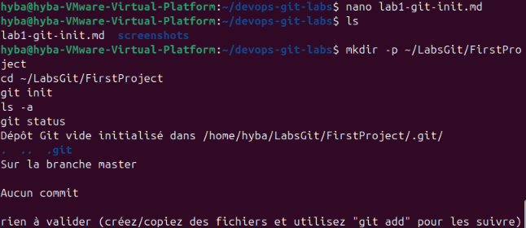

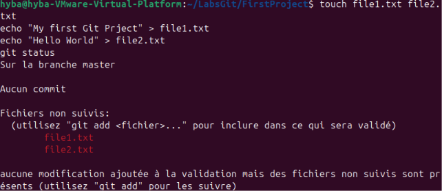

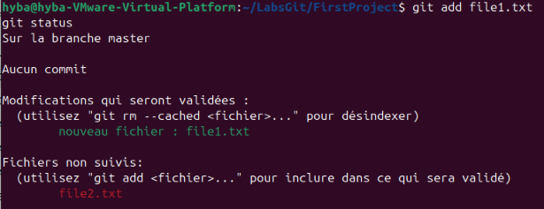

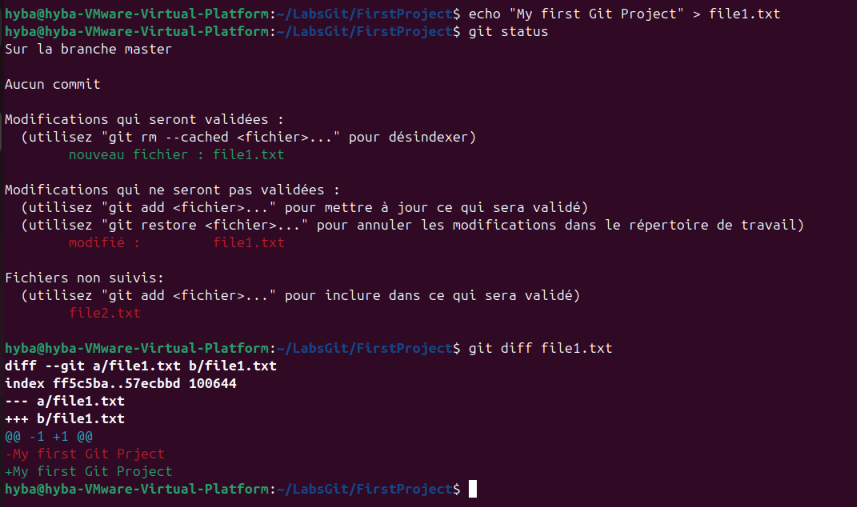

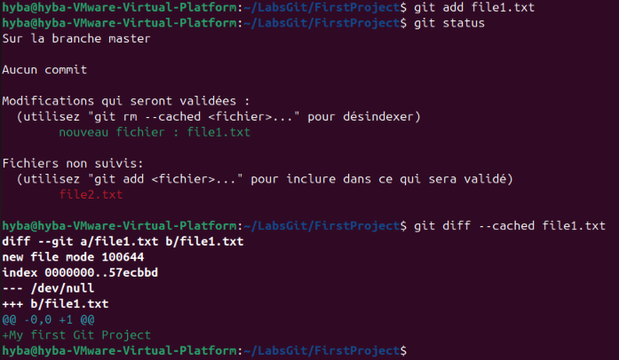

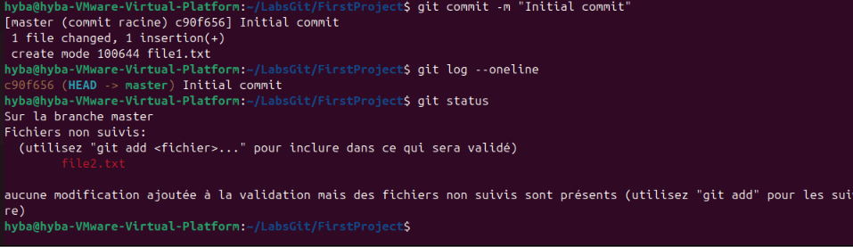

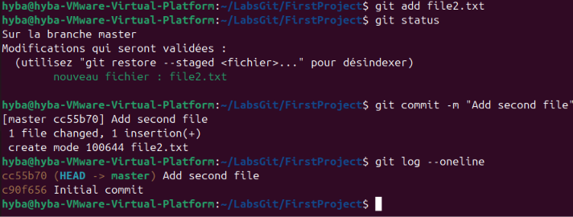

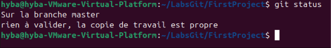


---


## 15. Captures du Lab 4

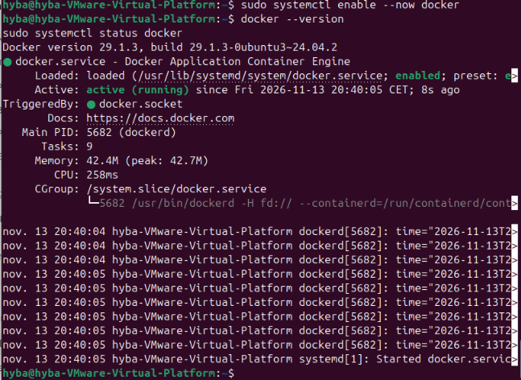

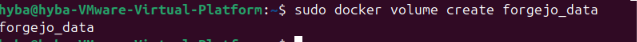

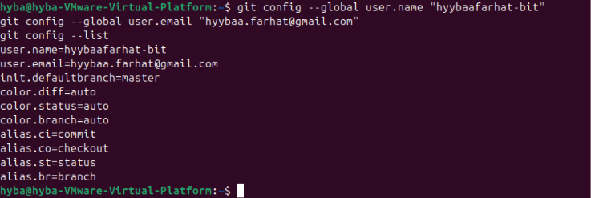

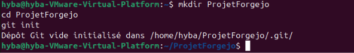

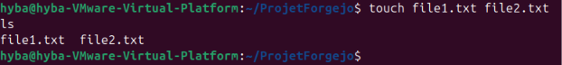

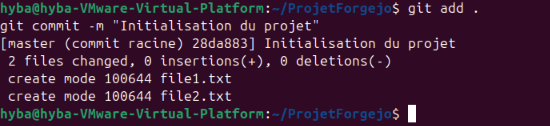

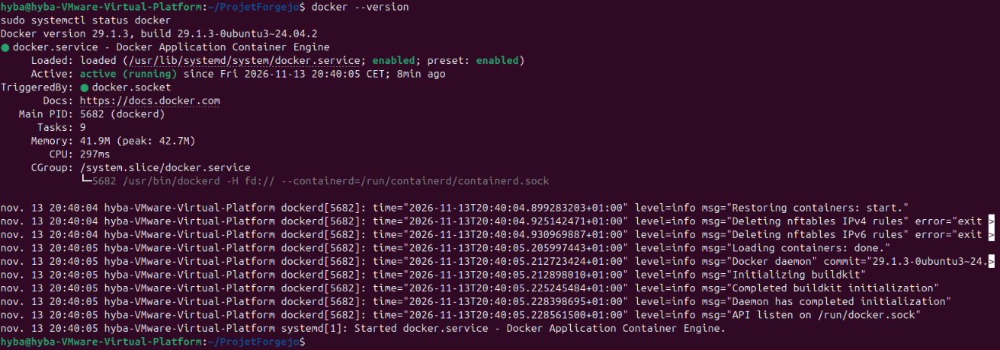

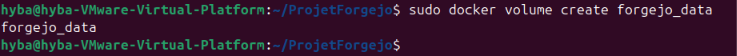

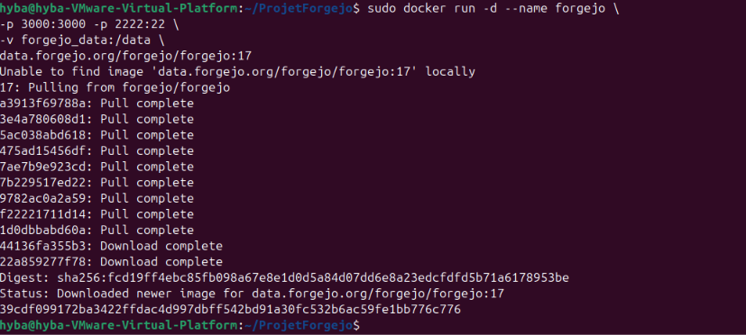


